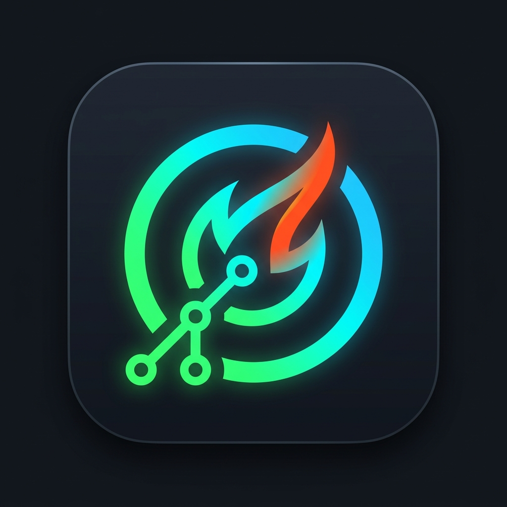

<p align="center">
  
</p>

<h1 align="center">GitHabit</h1>

<p align="center">
  <strong>The Ultimate Developer Habit Tracker & Code Pulse Engine</strong><br>
  <i>Build unstoppable momentum. Track GitHub commits, LeetCode solved problems, and daily habits in a tactile Bento Liquid-Glass interface.</i>
</p>

<p align="center">
  <a href="https://flutter.dev"></a>
  <a href="https://dart.dev"></a>
  <a href="https://github.com"></a>
  <a href="https://riverpod.dev"></a>
  <a href="https://hivedb.dev"></a>
  <a href="LICENSE"></a>
  <a href="https://github.com"></a>
</p>

---

## 💡 Why GitHabit?

Most habit trackers feel generic and disconnect developers from their actual work. **GitHabit** is engineered specifically for software engineers, open-source builders, and computer science students.

Instead of manual check-ins, GitHabit integrates directly with your developer lifecycle: your real **GitHub commits**, **LeetCode streak**, and **WakaTime coding hours** automatically validate your daily progress.

---

## ✨ Killer Features

### ⚡ 1. Zero-Effort Auto-Checkin
* Detects commits and contributions across your GitHub profile.
* Coding habits like *"Daily Commit"*, *"Solve LeetCode"*, or *"Review PRs"* are checked in **automatically in the background**.
* No manual tapping required—code and watch your streak light up.

### 🛡️ 2. Smart Streak Shield (Auto-Freeze)
* Life happens: vacations, exams, power outages, and production fires.
* If a day is missed and you have active shields, the **Smart Auto-Freeze engine** automatically preserves your hard-earned streak before reset.
* Never lose a 100+ day streak to unforeseen emergencies.

### 🟩 3. Interactive Bento Grid & Contribution Heatmap
* Ultra-responsive GitHub activity heatmap rendered with a custom high-performance canvas painter.
* 7-day circular streak gauges with glowing neon particle flames.
* Visual progress rings displaying Easy, Medium, and Hard LeetCode problem distribution.

### ⏱️ 4. Integrated Deep Work Pomodoro Timer
* Built-in 25/5 focus session timer with tactile haptics.
* Tracks daily completed sessions, cumulative focus minutes, and tags.
* Keeps you in flow state without context-switching between separate timer apps.

### 📊 5. WakaTime Coding Pulse
* Connect your WakaTime API key to monitor pure coding time across VS Code, Android Studio, Neovim, and JetBrains IDEs.
* Real-time breakdown of top languages: Dart, Rust, Go, TypeScript, Python, and C++.

### 🎨 6. Premium Obsidian & Liquid Sunset Design
* Tactile glassmorphism with frosted background blur (`BackdropFilter`).
* Switch between **Obsidian Dark** (cyberpunk neon green & cyan) and **Liquid Sunset** (warm amber flame glow).
* Zero layout overflow across any Android device screen size.

### 🔒 7. 100% Privacy-First & Local-First
* All habit logs, notes, and metrics are stored locally on-device using Hive.
* **Zero ads. Zero tracking SDKs. Zero third-party telemetry.**
* Personal Access Tokens (PAT) remain encrypted on your device.

---

## 🛠️ Architecture & Tech Stack

GitHabit follows **Clean Architecture** with a feature-first folder organization:

```
lib/
├── core/                        # Cross-cutting foundational modules
│   ├── database/                # Hive database service & box managers
│   ├── network/                 # Dio client with TLS & GitHub User-Agent
│   ├── theme/                   # Obsidian Dark theme, typography & palettes
│   └── widgets/                 # Reusable Bento cards & LiquidGlass containers
├── features/                    # Feature-first modular packages
│   ├── automation/              # Auto-Checkin, Auto-Freeze & notification coordinator
│   ├── dashboard/               # Main dashboard, Bento grid & DayStreak sheet
│   ├── freeze/                  # Streak Freeze state, shields & recovery logic
│   ├── github/                  # GraphQL & REST activity fetching and calculation
│   ├── habits/                  # Domain entities, streak calculator & CRUD
│   ├── profile/                 # Developer profile, Dev Card export & themes
│   ├── toolbox/                 # Floating toolbox, quick notes & scratchpad
│   └── wakatime/                # WakaTime stats dialog & language breakdowns
└── main.dart                    # App entrypoint & ProviderScope initialization
```

* **Framework:** [Flutter](https://flutter.dev) (Channel Stable 3.44+)
* **Language:** [Dart](https://dart.dev) (3.12+)
* **State Management:** [Riverpod](https://riverpod.dev) (`AsyncNotifierProvider`, `FutureProvider`)
* **Local Storage:** [Hive](https://docs.hivedb.dev/) (`hive_flutter`)
* **Networking:** [Dio](https://pub.dev/packages/dio)
* **Typography:** [Google Fonts](https://pub.dev/packages/google_fonts) (Inter, JetBrains Mono)
* **CI/CD:** GitHub Actions (Analyze, Coverage, Debug APK & Release AAB workflows)

---

## 🚀 Getting Started

### Prerequisites

* [Flutter SDK](https://docs.flutter.dev/get-started/install) (>= 3.24.0)
* Android Studio or VS Code with Flutter extension
* Java 17+ (for Android builds)

### Installation

1. **Clone the repository:**
   ```bash
   git clone https://github.com/your-username/GitHabit.git
   cd GitHabit
   ```

2. **Install dependencies:**
   ```bash
   flutter pub get
   ```

3. **Run code analysis:**
   ```bash
   flutter analyze
   ```

4. **Run test suite (49/49 unit & widget tests):**
   ```bash
   flutter test
   ```

5. **Launch the application:**
   ```bash
   # Run on connected Android device / emulator
   flutter run

   # Run on Chrome (Desktop Web Mode)
   flutter run -d chrome
   ```

---

## 📦 Building Production Releases

### Google Play Store (Android App Bundle)
```bash
flutter build appbundle --release
```
Artifact generated: `build/app/outputs/bundle/release/app-release.aab`

### Direct Install APK
```bash
flutter build apk --release
```
Artifact generated: `build/app/outputs/flutter-apk/app-release.apk`

---

## 🧪 Testing & Code Quality

The project maintains **100% passing tests** covering domain calculations, streak edge cases, and UI resilience:

```bash
flutter test
```
```
00:03 +49: All tests passed!
```

Key test suites:
* `streak_calculator_test.dart` — Timezone shifts, skipped days, and frozen chains.
* `automation_services_test.dart` — Background auto-checkins and smart shields.
* `widget_test.dart` — Narrow-screen overflow immunity (300px constraint verification).

---

## 🤝 Contributing

Contributions make the open-source community thrive!
1. Fork the Project
2. Create your Feature Branch (`git checkout -b feature/AmazingFeature`)
3. Commit your Changes (`git commit -m 'feat: Add AmazingFeature'`)
4. Push to the Branch (`git push origin feature/AmazingFeature`)
5. Open a Pull Request

---

## 📄 License

Distributed under the **MIT License**. See [`LICENSE`](LICENSE) for more information.

---

<p align="center">
  Crafted with 💚 for developers who code every day.
</p>
